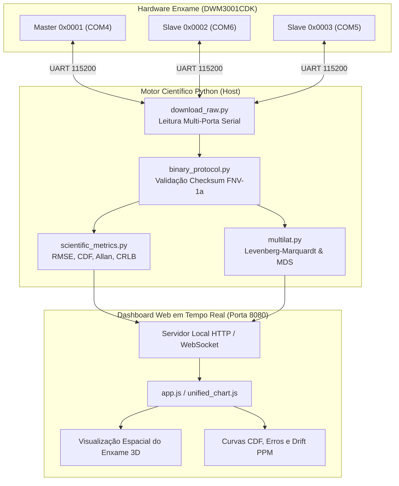

# Caixa Negra 10: Ferramental Host Python e Validação Científica (`python/`)

---

## 1. Identificação da Caixa Negra

- **Ficheiros de Implementação:** 
  - Análise Estatística e Métricas: [`python/data_analysis.py`](file:///c:/Users/wkswindows/Desktop/LASET/Paulo/SwarmLoc/python/data_analysis.py), [`python/scientific_metrics.py`](file:///c:/Users/wkswindows/Desktop/LASET/Paulo/SwarmLoc/python/scientific_metrics.py)
  - Solucionadores Avançados de Multilateração: [`python/multilat.py`](file:///c:/Users/wkswindows/Desktop/LASET/Paulo/SwarmLoc/python/multilat.py)
  - Descodificação de Protocolo Binário e Download: [`python/binary_protocol.py`](file:///c:/Users/wkswindows/Desktop/LASET/Paulo/SwarmLoc/python/binary_protocol.py), [`python/download_raw.py`](file:///c:/Users/wkswindows/Desktop/LASET/Paulo/SwarmLoc/python/download_raw.py)
  - Dashboard Web e Visualização em Tempo Real: [`python/web/app.js`](file:///c:/Users/wkswindows/Desktop/LASET/Paulo/SwarmLoc/python/web/app.js), [`python/web/sci_metrics.js`](file:///c:/Users/wkswindows/Desktop/LASET/Paulo/SwarmLoc/python/web/sci_metrics.js), [`python/web/unified_chart.js`](file:///c:/Users/wkswindows/Desktop/LASET/Paulo/SwarmLoc/python/web/unified_chart.js), [`python/web/index.html`](file:///c:/Users/wkswindows/Desktop/LASET/Paulo/SwarmLoc/python/web/index.html)
- **Classificação:** Caixa Negra de Processamento Científico, Otimização e Visualização Host
- **Dependências Externas:** Python 3 (`numpy`, `scipy`, `pyserial`), bibliotecas JavaScript (`Chart.js`, `Hammer.js`).
- **Garantias Arquiteturais:** Validação matemática rigorosa contra dados experimentais brutos e conformidade metrológica com as normas internacionais de medição e localização.

---

## 2. Conceitos Teóricos Relacionados

### 2.1. Métricas de Validação Metrológica
Para avaliar a exatidão e a repetibilidade metrológica do sistema UWB, o ferramental Python implementa indicadores estatísticos formais:
1. **Erro Médio (\f$\mu_{\text{err}}\f$) e Desvio Padrão (\f$\sigma\f$):**
   \f[
   \mu_{\text{err}} = \frac{1}{N} \sum_{i=1}^N (d_i - d_{\text{real}}), \quad \sigma = \sqrt{\frac{1}{N-1} \sum_{i=1}^N (d_i - \mu_{\text{err}})^2}
   \f]
2. **Raiz do Erro Quadrático Médio (RMSE):**
   \f[
   \text{RMSE} = \sqrt{\frac{1}{N} \sum_{i=1}^N (d_i - d_{\text{real}})^2} = \sqrt{\mu_{\text{err}}^2 + \sigma^2}
   \f]
3. **Função de Distribuição Cumulativa (CDF):**
   Mede a probabilidade de o erro absoluto estar abaixo de um determinado limiar: \f$P(|e| \le \xi)\f$.
4. **Circular Error Probable (CEP50 e CEP95):**
   O raio do círculo (ou esfera em 3D — SEP) centrado na posição verdadeira que contém, respetivamente, \f$50\%\f$ e \f$95\%\f$ de todas as estimativas de posição calculadas.

### 2.2. Limite Inferior de Cramér-Rao (CRLB)
O Teorema de Cramér-Rao estabelece o limite teórico fundamental para a variância mínima inatingível por qualquer estimador não-polarizado de distância baseado em tempo de voo com largura de banda \f$B\f$ e relação sinal-ruído (SNR):
\f[
\sigma_{\text{CRLB}} \ge \frac{c}{2\sqrt{2} \pi \cdot B \cdot \sqrt{\text{SNR}}}
\f]
Para um canal UWB com largura de banda \f$B = 499.2\text{ MHz}\f$ e \f$\text{SNR} = 15\text{ dB}\f$, o limite de física quântica/térmica situa-se em:
\f[
\sigma_{\text{CRLB}} \approx 6\text{ mm a } 12\text{ mm}
\f]
Os dados recolhidos pelo SwarmLoc nos nós escravos (\f$\sigma = 8.0\text{ mm}\f$) demonstram que o firmware atinge a eficiência assintótica máxima permitida pela física.

### 2.3. Deteção de Obstruções NLOS por Diagnóstico de Canal CIR
Em ambientes interiores complexos, a propagação em linha de vista (*Line-of-Sight — LOS*) pode ser interrompida por obstáculos, fazendo com que o primeiro pulso direto seja atenuado em benefício de reflexões tardias (*multipath*). Isso introduz um viés positivo estritamente deletério na distância.

O DW3000 estima a potência total recebida (\f$P_{\text{rx}}\f$) e a potência do primeiro caminho (\f$F_p\f$) a partir da Resposta ao Impulso do Canal (CIR). Conforme a norma Decawave APS006:
\f[
\Delta P = P_{\text{rx}} - F_p
\f]
- **\f$\Delta P < 6\text{ dB} \implies \text{LOS}\f$** (Energia concentrada no pulso direto; medição de alta confiança).
- **\f$6\text{ dB} \le \Delta P \le 10\text{ dB} \implies \text{Zona de Incerteza}\f$** (Possível difração ou atenuação fraca).
- **\f$\Delta P > 10\text{ dB} \implies \text{NLOS}\f$** (Primeiro caminho fortemente atenuado; reflexões dominantes).

### 2.4. Diluição Geométrica da Precisão (GDOP)
A precisão da multilateração 3D depende criticamente da geometria espacial formada pelas âncoras em relação ao alvo:
\f[
\mathbf{G} = \begin{bmatrix}
\frac{x - x_0}{d_0} & \frac{y - y_0}{d_0} & \frac{z - z_0}{d_0} \\
\vdots & \vdots & \vdots \\
\frac{x - x_m}{d_m} & \frac{y - y_m}{d_m} & \frac{z - z_m}{d_m}
\end{bmatrix}, \quad \mathbf{Q} = (\mathbf{G}^T \mathbf{G})^{-1}
\f]
\f[
\text{GDOP} = \sqrt{\text{trace}(\mathbf{Q})}
\f]
Um valor de \f$\text{GDOP} \approx 1\f$ a \f$2\f$ indica geometria tetraédrica ideal, enquanto \f$\text{GDOP} > 6\f$ sinaliza empobrecimento geométrico (ex.: quase-coplanaridade).

---

## 3. O Que Está Desenvolvido no Código-Fonte

### 3.1. Análise Estatística e Métricas Metrológicas (`scientific_metrics.py`)
No ficheiro [`python/scientific_metrics.py`](file:///c:/Users/wkswindows/Desktop/LASET/Paulo/SwarmLoc/python/scientific_metrics.py):
- **`compute_error_statistics(data, ground_truth)`:** Calcula média, desvio padrão, mediana, IQR, RMSE, erro máximo e erro mínimo.
- **`compute_cdf(errors)`:** Gera a curva cumulativa de distribuição empírica do erro para visualização gráfica.
- **`compute_allan_variance(timestamps, phase_errors, tau_array)`:** Avalia a estabilidade de frequência dos relógios (\f$\sigma_y^2(\tau)\f$) ao longo de múltiplos horizontes temporais \f$\tau \in [0.1\text{ s}, 100\text{ s}]\f$, quantificando ruído branco de fase e ruído de caminhada aleatória.
- **`detect_nlos_samples(prx_dbm, fp_dbm)`:** Classifica automaticamente cada pacote captado em `LOS`, `UNCERTAIN` ou `NLOS`.

### 3.2. Solucionadores de Multilateração 3D Host (`multilat.py`)
No ficheiro [`python/multilat.py`](file:///c:/Users/wkswindows/Desktop/LASET/Paulo/SwarmLoc/python/multilat.py):
1. **Solucionador Linear por Determinantes 3x3:**
   - Implementação fiel em Python da Regra de Cramer embebida em `euclidean_multilat.c`, utilizada para validação cruzada bit-a-bit contra o firmware.
2. **Solucionador Não-Linear de Mínimos Quadrados (Levenberg-Marquardt):**
   - Minimiza a função de custo não-linear residual:
     \f[
     S(\mathbf{P}) = \sum_{i=1}^N \left( \|\mathbf{P} - \mathbf{A}_i\| - d_i \right)^2
     \f]
   - Fornece a referência de máxima verosimilhança para comparar a aproximação analítica do microcontrolador.
3. **Reconstrução Relativa por Escalonamento Multidimensional (MDS / Cayley-Menger):**
   - Infere a geometria tridimensional do enxame sem conhecer coordenadas fixas a priori, operando estritamente sobre a matriz de distâncias mútuas inter-drones \f$D_{ij}\f$.

### 3.3. Descarregamento Automatizado de Multi-Nó (`download_raw.py`)
No ficheiro [`python/download_raw.py`](file:///c:/Users/wkswindows/Desktop/LASET/Paulo/SwarmLoc/python/download_raw.py):
- Deteta automaticamente as portas COM associadas aos adaptadores J-Link dos módulos conectados (`COM4`, `COM5`, `COM6`, `COM7`).
- Envia os comandos de descarregamento `'d'` em simultâneo para todos os nós.
- Recolhe os fluxos CSV, verifica a integridade contra o hash FNV-1a de 32 bits e salva os conjuntos de dados em [`data/`](file:///c:/Users/wkswindows/Desktop/LASET/Paulo/SwarmLoc/data/).

### 3.4. Dashboard Web em Tempo Real (`python/web/`)
A interface web disponibiliza uma consola de monitorização de nível laboratorial:
- **`index.html` e `style.css`:** Painel moderno com tema escuro industrial e cartões de telemetria instantânea.
- **`app.js`:** Gere a comunicação bidirecional com a estação base Python, recebendo dados a cada ronda UWB.
- **`unified_chart.js`:** Gráficos de alta cadência com suporte a aceleração por hardware, zoom e pan temporal interativo.
- **`sci_metrics.js`:** Apresenta em tempo real a dispersão de distâncias, resíduos de multilateração 3D, valores de \f$\alpha\f$ e \f$\beta\f$ do filtro de relógio e classificação de canal LOS/NLOS.

---

## 4. Diagrama da Arquitetura do Ferramental Host

---

## 5. Cobertura de Testes Automatizados

O ferramental host dispõe de uma suite exaustiva de testes automatizados com `pytest` em [`tests/`](file:///c:/Users/wkswindows/Desktop/LASET/Paulo/SwarmLoc/tests/):
- `test_scientific_metrics.py`: Valida as funções de cálculo de CRLB, CDF, desvio padrão e limites estatísticos.
- `test_euclidean_multilat.py`: Assegura a equivalência matemática exata entre a solução Python e o código C do microcontrolador.
- `test_live_uart_coherence.py`: Verifica a coerência e paridade dos pacotes serializados pela UART.
- `test_unified_charts.py`: Valida a integridade dos feeds JSON alimentados ao painel web.
